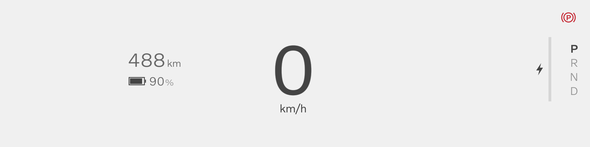
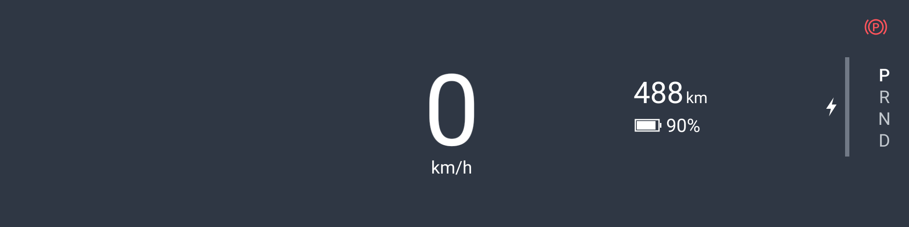
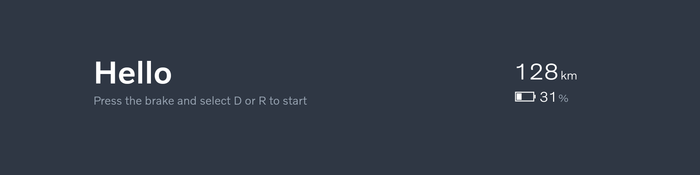
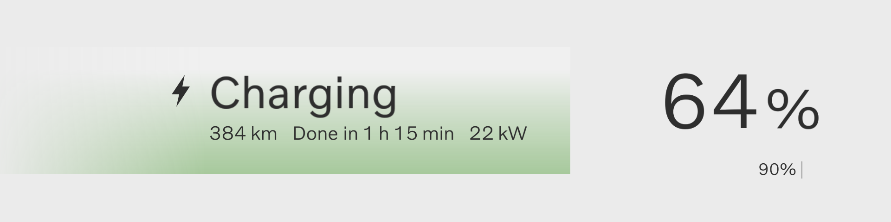
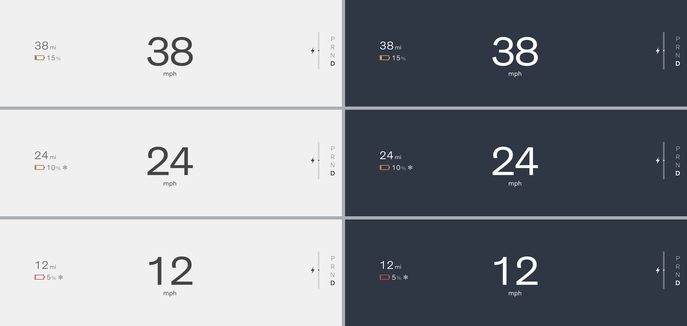
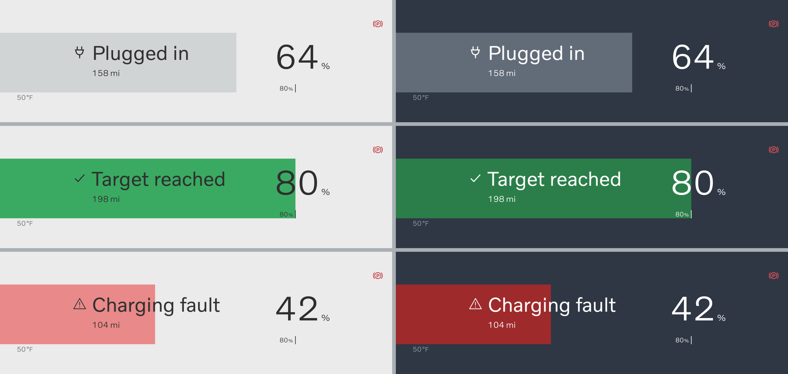

# EX30 Driver Display

A Bluetooth instrument display for the Volvo EX30. A read-only Android Automotive app sends readings directly to a Raspberry Pi. The instruments follow the layout of the **EX90 Calm** display, with the EX30's light and dark styling.

The two previews above come from the running Pi kiosk on a 1920 × 480 virtual screen. Speed uses **Volvo Novum Regular with tabular lining digits** when available. The EX30 emulator ships Novum Regular 2.001 at `/product/fonts/VolvoNovum-Regular.ttf`. The launcher and System UI contain identical copies. Its tabular 8 and 0 are 530 and 510 font units wide and both are 712 units tall. At the 139-pixel height in Volvo’s published EX30 Calm view, those outlines predict widths of 103.5 and 99.6 pixels. The image measures 104 and 100. The 12-pixel gap comes from the image. The factory screen’s exact text-style declaration on retail 2.x remains unverified. [Volvo’s EX30 Calm view](https://www.volvocars.com/uk/cars/ex30-electric/features/) · [Volvo’s archived EX30 emulator catalog](https://web.archive.org/web/20260903221015id_/https://developer.volvocars.com/sdk/volvo-sys-img.xml)

Speed is centred and occupies about 34% of the wide panel’s height, following the EX90 photograph. Its digit width and spacing follow the EX30 top strip. The gear column uses Novum SemiLight and Medium. [Volvo’s EX90 photograph, p. 43](https://www.volvocars-news.ch/wp-content/uploads/2022/12/Volvo_FTM_2_2022_DE.pdf#page=43)

Range and battery charge sit to the left of speed. Both use Novum SemiLight with tabular digits. SemiLight was the closest visual match to the EX30 top strip, with Regular a close second. The emulator’s decoded `activity_charging.xml` specifies 136 sp and 40 sp for its charging settings page. The top strip’s own font weight remains unverified. Volvo’s image shows a percent sign about 16–17 pixels tall beside 23-pixel numerals. The kiosk uses Novum’s shorter percent glyph at 72% of the digits’ visible height and aligns their bottoms. [Volvo’s EX30 Calm view](https://www.volvocars.com/uk/cars/ex30-electric/features/)

For these captures, a local Android test build loaded the three Novum faces from the archived EX30 emulator and sent the rendered lettering to the kiosk over Bluetooth. The distributed app looks up those faces on the car. When they are unavailable, it uses the bundled Inter at weight 330 for range and charge and 360 for speed.

## Connect

1. Install the Pi display on a Raspberry Pi with Bluetooth Classic and an attached screen.
2. Open **EX30 Driver Display** on the parked car and tap **Find display**. Grant the vehicle and Nearby devices permissions Android requests.
3. Select the **EX30 Display** name shown on the Pi and approve Android’s pairing dialog. The Pi needs only its screen. Subsequent trips reuse the saved bond.

No Wi-Fi password, camera, OBD adapter or internet connection is needed for the drive. This fork has its own Android application ID. See the installation and build steps, including retail installation availability. [Setup guide](SETUP.md)

## What appears on screen

| Instrument | Source and behavior |
| --- | --- |
| Speed | Calibrated display speed from the EX30. The unit follows the car’s exposed preference. |
| Range | The car’s remaining-range estimate in miles or kilometres. Distance and speed units are independent. |
| Battery | Percentage calculated from remaining energy and usable capacity, with nominal capacity as a fallback. The battery icon changes from neutral to amber at 15%, orange at 10%, and red at 5%. The car’s low-energy flag can also turn it amber. |
| Cold battery | A snowflake appears beside the battery percentage when the car reports a pack temperature below 0°C (32°F). |
| Gear and parking brake | The selected P, R, N or D is highlighted. The red parking-brake symbol follows its own switch. |
| Power and charging | A signed battery-power bar estimates draw and regeneration. A plug appears when the cable is connected. The factory meter’s available-power limits and friction-brake section require more signals. |
| Day and night | The app sends AAOS’s current appearance, including changes while the setup screen is closed. The cabin night flag is a fallback. |

A missing speed displays a dash. Each snapshot replaces all the previous readings. If the car goes silent for three seconds, the Pi clears the instruments. The photograph’s recognized speed-limit sign, automatic-wiper indicator and position lamps are left empty because this app has no verified read for their factory states. Use the car’s instruments for warnings. [Vehicle signals](ex30-companion-aaos/docs/properties.md)

## Welcome

When the car first reports Park and zero speed after waking, the display fades in “Hello” and a short starting prompt. Range and battery appear on the right in the car’s units. The layout follows the EX90 shown in the road test. The 320 ms fade is this project’s timing. [EX90 dashboard walk-through](https://www.youtube.com/watch?v=7fxO3fzyoW0&t=892s) · [Volvo’s starting instructions](https://www.volvocars.com/uk/support/car/ex90/article/47d2c97fd33effd3c0a8cc3718c999b7-58bf8ef6ce7e618dc0a8b04a2f79ccf2-8664b2fa77a7e089c0a8296870d1a409/47d2c97fd33effd3c0a8cc3718c999b7-4e78107d596eb7b6c0a8b0970bdcd43f-8664b2fa77a7e089c0a8296870d1a409/) · [Welcome in daylight](docs/welcome-day.png) · [Animated transition](docs/welcome-to-drive.gif)

Selecting D, R or N, or detecting motion, starts a 320 ms crossfade. The greeting, starting prompt and right-hand readings fade out together as they move four pixels down at the design resolution. The complete driving display fades in at its final positions, with speed, gear and range updating live. The car app remembers that driving has started across Bluetooth reconnects and later stops in Park. Its existing screen and ignition signals rearm the greeting for the next wake. A connected cable keeps the charging or parked plug view.

On the first shift from Park into Drive or Reverse, a small green **READY** appears below the battery row, aligned with the left edge of the range and battery icon. It clears above 5 km/h (about 3 mph) or when you select Park or Neutral and stays off at traffic lights. The app infers this cue from gear and speed. The 5 km/h cutoff is our interpretation of Volvo’s “walking pace.” [EX90 starting sequence](https://www.volvocars.com/us/support/car/ex90/article/47d2c97fd33effd3c0a8cc3718c999b7-4e78107d596eb7b6c0a8b0970bdcd43f-8664b2fa77a7e089c0a8296870d1a409/) · [Day preview](docs/ready-day.png) · [Night preview](docs/ready-night.png)

The small odometer in the reference is omitted. The archived EX30 image declares only the privileged mileage permission. Newer Android versions also define a third-party mileage permission. [Android odometer property](https://developer.android.com/reference/android/car/VehiclePropertyIds#PERF_ODOMETER)

## Charging

The solid green bar spans 61% of the instrument face’s height, matching Volvo’s EX90 illustration. Its width shows the battery’s current charge. “Charging” and the session details stay on the left, and the large battery percentage stays on the right. Its percent sign is one quarter the height of the digits. Changing the charge limit moves the small label and its vertical line along the same scale as the fill. The label sits just left of the line unless a target near zero leaves too little room. [Volvo’s EX90 instrument-panel illustration](https://www.volvocars.com/media/support-content/img2bd25bed8087ea7ac0a801f2015637bf_1_--_--_SVG.png) · [EX90 charging test at an 80% target](https://www.youtube.com/watch?v=7fxO3fzyoW0&t=390s) · [Kiosk in dark mode](docs/charging-night.png)

Volvo’s EX30 charging illustration shows a solid green (`#2b7e49`) on charcoal. The kiosk uses that green at night and a brighter shade of the same hue (`#3aaa62`) by day so the dark lettering stays readable over the bar. The whole fill pulses together while charging. [U.S. charging status guide](https://www.volvocars.com/us/support/car/ex30/article/a3d4c324d33d417cc0a8cc37744d76ea-ec8b59f1d33539aec0a8cc374c819eab-77f3800cb793a946c0a8b05d49c187d2/) · [2025 Canadian guide](https://www.volvocars.com/en-ca/support/car/ex30/2025/article/a3d4c324d33d417cc0a8cc37744d76ea-ec8b59f1d33539aec0a8cc374c819eab-77f3800cb793a946c0a8b05d49c187d2/)

The light grey background comes from the EX30 emulator’s built-in manual. Its `assets/default/user_manual.json` identifies car software `1.0` and content `23w38d`. The English charging article points to `img504ec2510898026ec0a801f21c4aa44d_1_--_--_SVG.svg` in `assets/default/documentAssetBundle.zip` inside `UserManual.apk`. That older illustration has a sage-green gradient.

The signed Android emulator image was built May 15, 2025. Its configured cluster APK labels itself “Fake Cluster Implementation” and displays Android’s sample instruments. The day and night gradient drawables in `XCSettings2_Gecko.apk` belong to the center-screen charging settings. The production EX30 top strip’s fill and animation on software 1.8 and 2.x remain unverified. [Android’s sample cluster service](https://source.android.com/docs/automotive/displays/cluster_api) · [Volvo’s software release dates](https://www.volvocars.com/uk/support/car/ex30/software-release-notes/)

The same parked layout shows **Plugged in** with a neutral bar, **Target reached** with steady green, and **Charging fault** with steady red. The target can be below 100%. Completion and fault each require an explicit report from the car. A connected cable alone qualifies for the neutral state. Only active charging pulses and shows net kW and the available time estimate. Selecting D, R or N or detecting motion restores the instruments immediately. [Charging signals and availability](ex30-companion-aaos/docs/properties.md)

Volvo documents low-charge warnings at 15%, 10%, 5%, and 0%. The amber, orange and red bands are this display’s interpretation of those milestones. The pack snowflake uses Android’s average battery temperature and Volvo’s published freezing threshold. Volvo’s factory sensor selection and exact low-charge colors on a retail 2.x strip remain unverified. [EX30 release notes](https://www.volvocars.com/us/support/car/ex30/software-release-notes/) · [Volvo’s cold-battery indicator](https://www.volvocars.com/us/support/car/ex30/article/f558786dce01385ec0a8b04a5cd4f99b-382ed7f148ede59fc0a8004a48515dfc-d5ea19374a848da4c0a8b097474f8a2b/)

Volvo places the clock, outside temperature and cold-air snowflake in the EX90’s center touchscreen status bar. The Pi follows the EX90 instrument panel’s placement of the cold-battery snowflake beside the charge percentage. [EX90 center display symbols](https://www.volvocars.com/en-ca/support/car/ex90/article/fa683eafd4b47850c0a8cc3708e5f447-7c728792d3b6ebc6c0a8cc373f75534a-8664b2fa77a7e089c0a8296870d1a409/) · [EX90 battery meter](https://www.volvocars.com/en-ca/support/car/ex90/article/47d2c97fd33effd3c0a8cc3718c999b7-d88cae054b0cabbbc0a8b09745ef70a6-8664b2fa77a7e089c0a8296870d1a409/)

These 12 kiosk captures at 1280 × 400 use readings from a fresh Bluetooth pairing with Google’s Android 15 Automotive emulator. Light mode is on the left. The driving examples have pack temperatures of 8°C at 15%, −4°C at 10% and −3°C at 5%. The lower two rows show the battery snowflake. [Battery indicator detail](docs/battery-temperature-detail.png)

## Verification

Tested with Google’s Android 15 Automotive emulator and a separate ARM64 Linux VM running BlueZ and the Pi receiver. The two systems paired over virtual Bluetooth radios with Wi-Fi disabled. The display followed active charging and day/night changes. It also recovered after an Android reboot and a receiver restart, and cleared a frozen speed reading in about three seconds before reconnecting. The renderer tests cover wide and 16:9 screens. This fork has been tested in emulation only. A physical Raspberry Pi, panel and retail EX30 still need testing, including Bluetooth pairing and the availability of pack temperature and charging states. [Live kiosk frame with 60 mph, 100 mi of range and 90% charge](docs/live-mph.png)

The welcome flow was also exercised over the paired virtual radios. Selecting a driving gear dismissed the greeting, reconnecting in Park kept the driving instruments, and an ignition sleep/wake cycle restored the greeting. The welcome screenshots and animation come from the Linux kiosk replaying those Android readings and rendered Novum lettering.

## Project

The car app lives in `ex30-companion-aaos/`. The Pi kiosk, renderer and installer live in `display/`. The original `ex30-companion-runner/` remains in the shared history and source tree for upstream merges. This fork’s installer launches the Bluetooth kiosk. [Original project by ifmeidan](https://github.com/ifmeidan/ex-30-driver-display)

The EX30 day and night screen images supplied the main foreground and background colours. The colours on any individual panel depend on its calibration. [Volvo EX90 Calm manual](https://www.volvocars.com/static/support-content/pdfs/uk_en-GB_ex90_2025_UM_56de2ae2718076a243a7173854585416.pdf) · [EX30 day reference](https://www.volvocars.com/uk/cars/ex30-electric/features/) · [EX30 night reference](https://www.vosautobedrijven.nl/modellen/volvo-ex30/)
